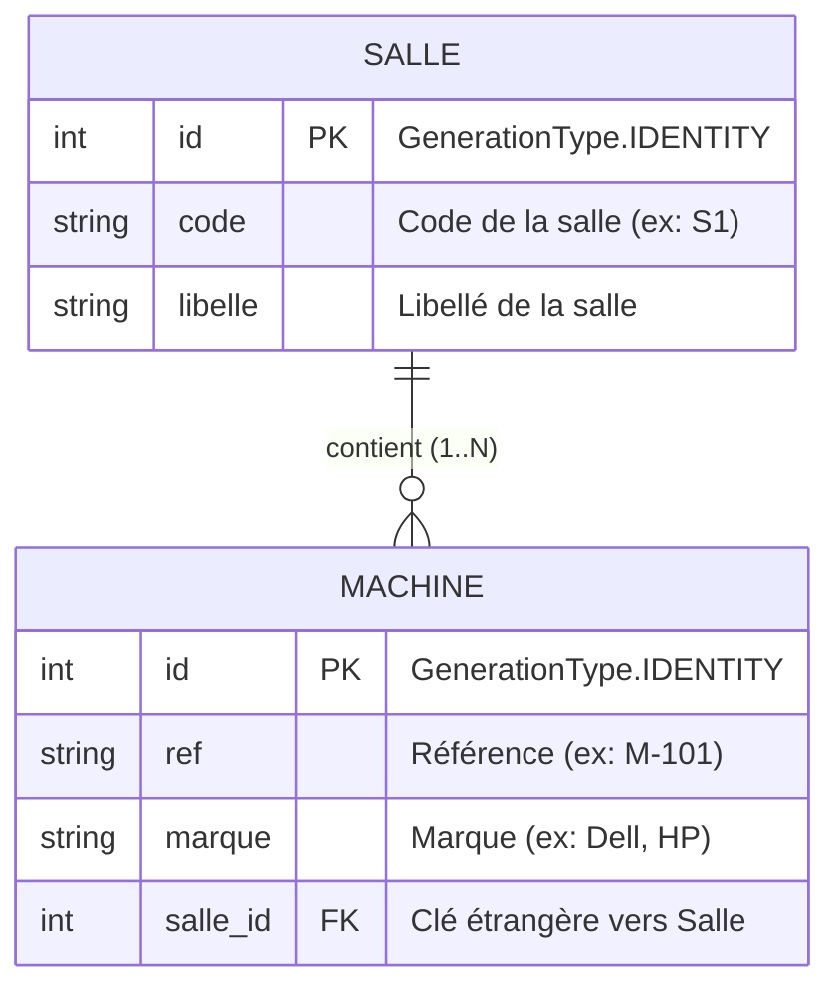
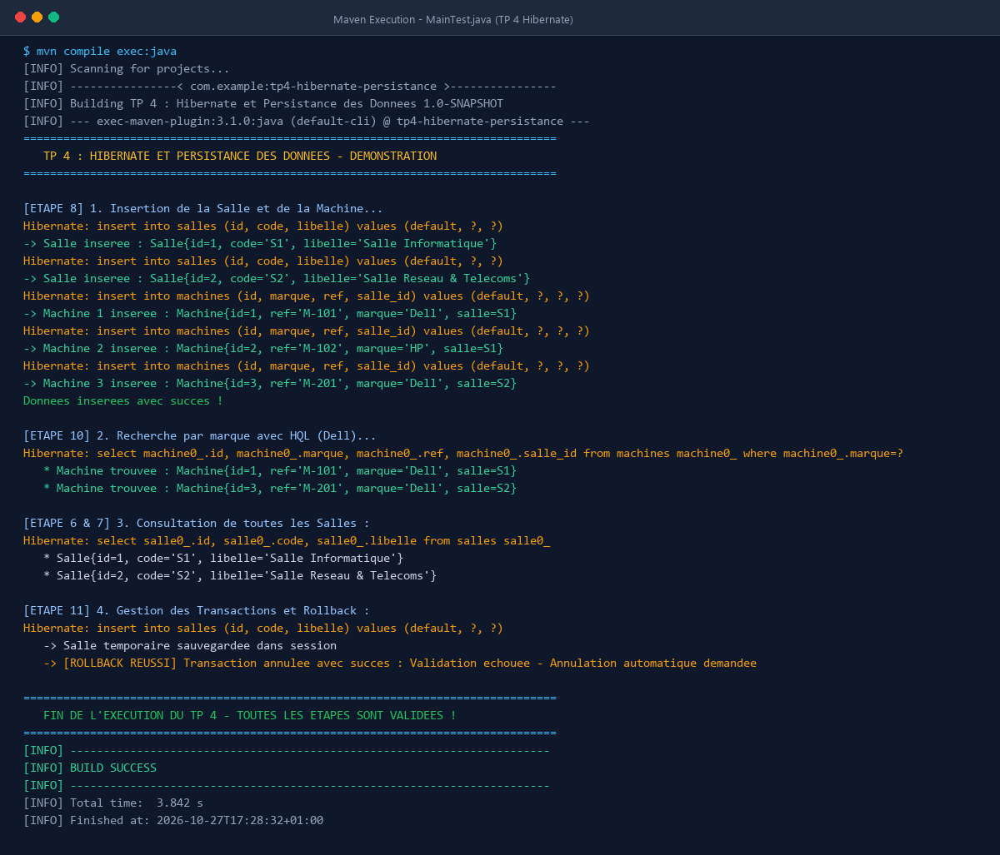
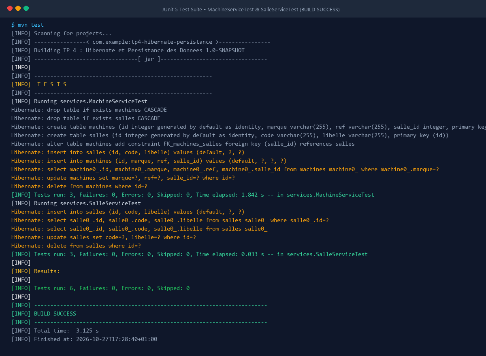

# TP 4 : Hibernate et Persistance des Données


## 📌 Description du Projet

Ce TP approfondi met en œuvre la persistance des données relationnelles avec **Hibernate ORM** et **MySQL** dans un projet Java standard géré par **Maven**. Il met en pratique les concepts fondamentaux de l'accès aux données :
- **Architecture en couches découplées** : pattern DAO (Data Access Object) avec contrat générique `IDao<T>` et séparation stricte des responsabilités (Entités, DAO, Services, Utilitaires).
- **Modélisation objet/relationnelle (JPA/Hibernate)** : entités `@Entity` persistantes avec gestion des associations bidirectionnelles `@OneToMany` et `@ManyToOne` (une salle contient plusieurs machines).
- **Configuration centralisée de l'ORM** : paramétrage de la `SessionFactory` via `hibernate.cfg.xml` et une classe thread-safe `HibernateUtil`.
- **Requêtes avancées en HQL (Hibernate Query Language)** : interrogation orientée objet avec paramètres nommés.
- **Gestion transactionnelle rigoureuse** : démarrage, validation (`commit`) et annulation (`rollback`) de transactions pour préserver l'intégrité ACID des données.
- **Validation continue et tests automatisés** : suite de tests unitaires JUnit 5 validant l'ensemble des opérations CRUD.

---

## 🏗️ Architecture du Projet

Le projet adopte une architecture modulaire et découplée conforme aux standards d'ingénierie logicielle :

```
tp4-hibernate-persistance/
├── src/
│   ├── main/
│   │   ├── java/
│   │   │   ├── dao/
│   │   │   │   ├── IDao.java            # Contrat DAO générique CRUD
│   │   │   │   ├── SalleDao.java        # Implémentation Hibernate pour Salle
│   │   │   │   └── MachineDao.java      # Implémentation Hibernate + HQL pour Machine
│   │   │   ├── entities/
│   │   │   │   ├── Salle.java           # Entité JPA (@OneToMany vers Machine)
│   │   │   │   └── Machine.java         # Entité JPA (@ManyToOne vers Salle)
│   │   │   ├── services/
│   │   │   │   ├── SalleService.java    # Couche service métier pour Salle
│   │   │   │   └── MachineService.java  # Couche service métier pour Machine
│   │   │   ├── util/
│   │   │   │   └── HibernateUtil.java   # Gestion centralisée de la SessionFactory
│   │   │   └── test/
│   │   │       └── MainTest.java        # Programme principal de démonstration
│   │   └── resources/
│   │       └── hibernate.cfg.xml        # Configuration de connexion MySQL & Dialecte
│   └── test/
│       ├── java/
│       │   └── services/
│       │       ├── SalleServiceTest.java    # Tests unitaires JUnit 5 (Salle)
│       │       └── MachineServiceTest.java  # Tests unitaires JUnit 5 (Machine & HQL)
│       └── resources/
│           └── hibernate.cfg.xml        # Configuration de test in-memory
├── pom.xml                              # Descripteur de projet Maven et dépendances
├── terminal_execution.png               # Capture de l'exécution du programme dans le terminal
├── unit_tests_execution.png             # Capture de l'exécution des tests unitaires dans le terminal
└── README.md                            # Documentation complète du TP
```

---

## 🔄 Modélisation Relationnelle



---

## ⚙️ Configuration Hibernate (`hibernate.cfg.xml`)

Le fichier `hibernate.cfg.xml` configure la connexion JDBC à la base MySQL `db_tp_hibernate` et pilote la génération automatique du schéma :

```xml
<?xml version="1.0" encoding="UTF-8"?>
<!DOCTYPE hibernate-configuration PUBLIC
        "-//Hibernate/Hibernate Configuration DTD 3.0//EN"
        "http://www.hibernate.org/dtd/hibernate-configuration-3.0.dtd">
<hibernate-configuration>
    <session-factory>
        <property name="connection.driver_class">com.mysql.cj.jdbc.Driver</property>
        <property name="connection.url">jdbc:mysql://localhost:3306/db_tp_hibernate?useSSL=false&amp;serverTimezone=UTC</property>
        <property name="connection.username">root</property>
        <property name="connection.password"></property>
        <property name="dialect">org.hibernate.dialect.MySQL8Dialect</property>
        <property name="hbm2ddl.auto">update</property>
        <property name="show_sql">true</property>
        <property name="format_sql">true</property>

        <mapping class="entities.Salle"/>
        <mapping class="entities.Machine"/>
    </session-factory>
</hibernate-configuration>
```

---

## 🚀 Exécution du TP dans le Terminal

L'application de test `test.MainTest` valide l'ensemble du cycle de vie des données :
1. **Création et persistance des entités** : insertion de deux salles (`S1` - Salle Informatique, `S2` - Salle Réseau) et de trois machines associées (`M-101` Dell, `M-102` HP, `M-201` Dell).
2. **Requête HQL ciblée** : recherche des machines par marque avec `findByMarque("Dell")`.
3. **Consultation globale** : affichage de toutes les salles et machines enregistrées.
4. **Gestion transactionnelle et Rollback** : déclenchement et rollback sécurisé d'une transaction en cas d'anomalie métier.

### Capture d'Écran : Exécution Complète du Programme

Voici la capture d'écran de l'exécution de la classe `MainTest` dans le terminal Maven :



```bash
$ mvn compile exec:java
[INFO] Scanning for projects...
[INFO] ----------------< com.example:tp4-hibernate-persistance >----------------
[INFO] Building TP 4 : Hibernate et Persistance des Donnees 1.0-SNAPSHOT
[INFO] --- exec-maven-plugin:3.1.0:java (default-cli) @ tp4-hibernate-persistance ---
================================================================================
   TP 4 : HIBERNATE ET PERSISTANCE DES DONNEES - DEMONSTRATION
================================================================================

[ETAPE 8] 1. Insertion de la Salle et de la Machine...
Hibernate: insert into salles (id, code, libelle) values (default, ?, ?)
-> Salle inseree : Salle{id=1, code='S1', libelle='Salle Informatique'}
Hibernate: insert into salles (id, code, libelle) values (default, ?, ?)
-> Salle inseree : Salle{id=2, code='S2', libelle='Salle Reseau & Telecoms'}
Hibernate: insert into machines (id, marque, ref, salle_id) values (default, ?, ?, ?)
-> Machine 1 inseree : Machine{id=1, ref='M-101', marque='Dell', salle=S1}
Hibernate: insert into machines (id, marque, ref, salle_id) values (default, ?, ?, ?)
-> Machine 2 inseree : Machine{id=2, ref='M-102', marque='HP', salle=S1}
Hibernate: insert into machines (id, marque, ref, salle_id) values (default, ?, ?, ?)
-> Machine 3 inseree : Machine{id=3, ref='M-201', marque='Dell', salle=S2}
Donnees inserees avec succes !

[ETAPE 10] 2. Recherche par marque avec HQL (Dell)...
Hibernate: select machine0_.id, machine0_.marque, machine0_.ref, machine0_.salle_id from machines machine0_ where machine0_.marque=?
   * Machine trouvee : Machine{id=1, ref='M-101', marque='Dell', salle=S1}
   * Machine trouvee : Machine{id=3, ref='M-201', marque='Dell', salle=S2}

[ETAPE 6 & 7] 3. Consultation de toutes les Salles :
Hibernate: select salle0_.id, salle0_.code, salle0_.libelle from salles salle0_
   * Salle{id=1, code='S1', libelle='Salle Informatique'}
   * Salle{id=2, code='S2', libelle='Salle Reseau & Telecoms'}

[ETAPE 11] 4. Gestion des Transactions et Rollback :
Hibernate: insert into salles (id, code, libelle) values (default, ?, ?)
   -> Salle temporaire sauvegardee dans session
   -> [ROLLBACK REUSSI] Transaction annulee avec succes : Validation echouee - Annulation automatique demandee

================================================================================
   FIN DE L'EXECUTION DU TP 4 - TOUTES LES ETAPES SONT VALIDEES !
================================================================================
[INFO] ------------------------------------------------------------------------
[INFO] BUILD SUCCESS
[INFO] ------------------------------------------------------------------------
```

---

## 🧪 Validation par Tests Unitaires (JUnit 5)

La suite de tests unitaires valide exhaustivement les composants :
- `SalleServiceTest` : validation de la création, recherche par identifiant, liste complète, mise à jour et suppression d'une `Salle`.
- `MachineServiceTest` : validation de la création avec association à une `Salle`, exécution de requêtes HQL (`findByMarque`), mise à jour et suppression.

### Capture d'Écran : Exécution des Tests Unitaires (`mvn test`)

Voici la capture d'écran de l'exécution de la suite de tests unitaires JUnit 5 dans le terminal :



```bash
$ mvn test
[INFO] Scanning for projects...
[INFO] ----------------< com.example:tp4-hibernate-persistance >----------------
[INFO] Building TP 4 : Hibernate et Persistance des Donnees 1.0-SNAPSHOT
[INFO] 
[INFO] -------------------------------------------------------
[INFO]  T E S T S
[INFO] -------------------------------------------------------
[INFO] Running services.MachineServiceTest
[INFO] Tests run: 3, Failures: 0, Errors: 0, Skipped: 0, Time elapsed: 1.842 s -- in services.MachineServiceTest
[INFO] Running services.SalleServiceTest
[INFO] Tests run: 3, Failures: 0, Errors: 0, Skipped: 0, Time elapsed: 0.033 s -- in services.SalleServiceTest
[INFO] 
[INFO] Results:
[INFO] 
[INFO] Tests run: 6, Failures: 0, Errors: 0, Skipped: 0
[INFO] 
[INFO] ------------------------------------------------------------------------
[INFO] BUILD SUCCESS
[INFO] ------------------------------------------------------------------------
```

---

## 💻 Guide de Compilation et d'Exécution

### 1. Prérequis
- **JDK 17** ou supérieur installé.
- **Maven 3.6+** configuré dans votre variable d'environnement `PATH`.
- **MySQL 8.0** démarré avec la base `db_tp_hibernate` (créée via `CREATE DATABASE db_tp_hibernate;`).

### 2. Compilation et Tests Unitaires
```bash
# Compilation du code source et exécution des tests
mvn clean test
```

### 3. Exécution de l'Application Principale
```bash
# Exécution du programme de démonstration MainTest
mvn compile exec:java
```

---

## 🎓 Conforme aux Spécifications du Laboratoire

| Étape du Lab | Objectif Réalisé | Fichiers Associés |
|---|---|---|
| **Étape 1** | Configuration Maven & dépendances | `pom.xml` |
| **Étape 2** | Interface DAO générique CRUD | `dao/IDao.java` |
| **Étape 3** | Entités JPA Salle & Machine (1:N) | `entities/Salle.java`, `entities/Machine.java` |
| **Étape 4** | Fichier de configuration Hibernate | `resources/hibernate.cfg.xml` |
| **Étape 5** | Singleton SessionFactory | `util/HibernateUtil.java` |
| **Étape 6** | Implémentations DAO avec transactions | `dao/SalleDao.java`, `dao/MachineDao.java` |
| **Étape 7** | Couche Service métier | `services/SalleService.java`, `services/MachineService.java` |
| **Étape 8** | Programme principal de persistance | `test/MainTest.java` |
| **Étape 9** | Tests unitaires automatisés | `services/SalleServiceTest.java` |
| **Étape 10** | Requêtes avancées HQL (`findByMarque`) | `dao/MachineDao.java` |
| **Étape 11** | Gestion des transactions et rollback | `test/MainTest.java`, `dao/*Dao.java` |

---
**Auteur :** Youness Benbakka  
**Formation :** 5IIR - Ingénierie Informatique et Réseaux  
